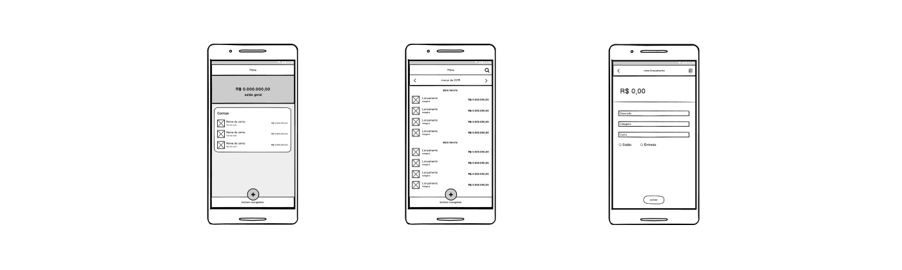
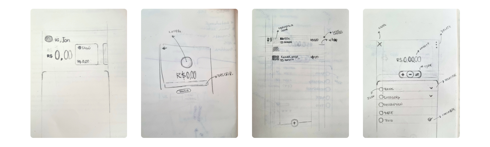
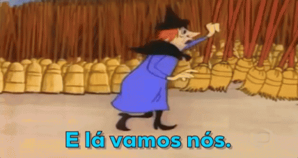
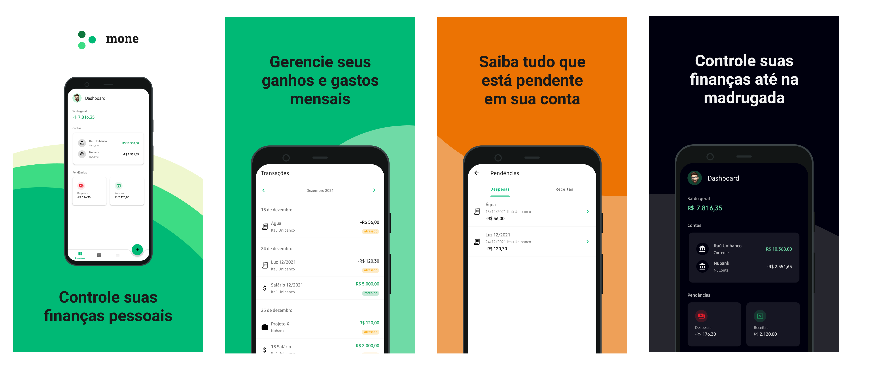
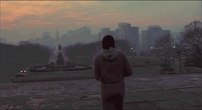

## TL;DR

> The story of Mone, my personal finance app: how it went from a course capstone project in 2018, through a few times I gave up, to Google Play at the end of 2021, and what I learned about breaking big goals into small wins.

<!--more-->

## Introduction

Mone started as the final course project, called the capstone, that I built in **2018** for **Udacity**'s **Android Nanodegree** program. Back then we had to apply everything we had learned during the program to an open-themed project, and since I was working in the financial market I decided to build an app that could record income and expenses in a very simple way.

When I finished the project I thought about publishing it to the store and continuing its development, but since I didn't consider it relevant, and assumed nobody would use something so simple, I decided not to go ahead and set the project aside.

Over the years, I got into the habit of managing my personal finances and started using services that could help me with it. After many frustrated attempts, I found an app that has helped me a lot ever since.

After using this service for a long time, I realized some features could work a little differently for me, and that's when the motivation to continue that old project came back once again.

I remember writing down some cool ideas I thought would be interesting to have in the app, sketching a few prototypes and choosing which technologies I would use to build my idea.

After finishing my notes, I turned on my laptop, cloned the old project and, excited to apply everything I had learned in the last few years building apps, made my first commit 🚀.

## The syndrome

Months went by, many hours of work dedicated to the project, and soon the feeling that nothing was moving forward started to creep in 😑…that's because many ideas I had at the start of the project had a much bigger scope than I imagined, and I had no idea how much work it would be to build something from scratch: thinking about the experience, data modeling, building the backend, then the frontend and finally publishing to the store. Doing all of that alone became a huge challenge for me…and once again, I found a reason to give up on the project, thinking I wouldn't be able to finish what I had planned…

## The end of procrastination

After a few days without writing a single line of code, unmotivated and frustrated once again, I decided to use my free time to start reading a book that had been on my shelf for a while, called [**The End of Procrastination**](https://www.amazon.com.br/fim-procrastina%C3%A7%C3%A3o-Petr-Ludwig/dp/8543109353). The funny thing was that with every page I read, I realized my perception of how I was handling the project, my doubts and my worries were completely wrong. To keep it short, one of the most important messages I took from this book was:

> “No matter how complex your goals are, break them into smaller scopes, stay consistent, build good habits and reward your small wins, and that will give you an amazing journey”

After a few weeks of reading and a lot of notes, I realized I could see things a little differently and how I could better drive the evolution of this project, through new habits like planning what I would do during the week instead of just doing whatever was on my mind, breaking more complex features into smaller scopes, setting aside time to study without blaming myself for not working directly on the project, and enjoying each small win more without being so hard on myself as I had been. I stopped thinking only about the end result, which could take months, maybe years, to reach what I imagined was “ideal for me”, and that made things lighter and more productive.

## Here we go…

**Heeeere we go lol**, back to the project table, with new excitement. I listed all the pending tasks, split more complex topics into smaller scopes, dropped things I felt didn't make much sense at that moment, defined an MVP and moved on, day after day, coding non-stop, studying new tools and libraries to integrate into the project until my *to-do* list was empty.

I remember that near the end of the year, exactly on **December 27, 2021**, I finally published the first version of the app on [**Google Play**](https://play.google.com/store/apps/details?id=br.com.mone), still in its *alpha* version, with a few bugs, but that's okay, right 🙃… that day was a very important milestone for me. Even knowing I would need to fix some things and build many others, I knew enjoying that moment would be very important.

Since then I've been working on this side project, little by little evolving architectural concepts, building new features, improving the user experience and other ideas that stayed in the backlog.

## What I learned

Throughout the whole process I got to use some really cool tools I had never used or had little contact with, like Figma for design and screen prototyping, authentication rules setup, contextual remote configs, analytics, NoSQL data modeling, bucket configuration, etc.

I'd say it was one of the best experiences I've had in a while: the feeling of overcoming every challenge I faced during development, especially having given up several times but still reaching one of the most important milestones I had planned. Those are the reasons this journey became even more meaningful to me.

Today I'd say Mone has become my main app for managing my personal finances. Even though it's very simple and has only a few features, I'm still excited to keep working on this project 🙌.

> It doesn't matter how hard you hit, but how hard you can get hit and keep going. How much you can take and keep moving forward. That's how you win.
>
> **— Rocky Balboa**
